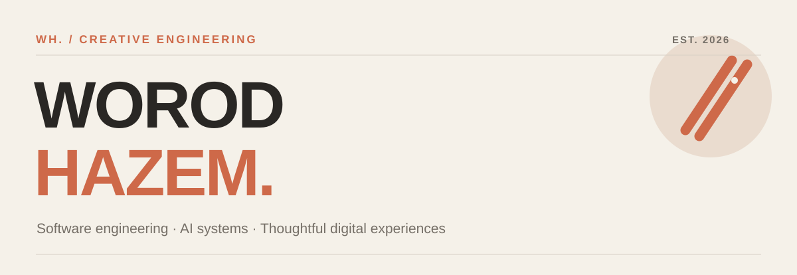
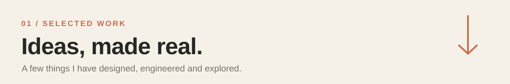
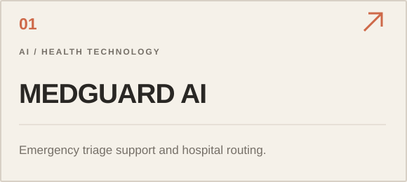
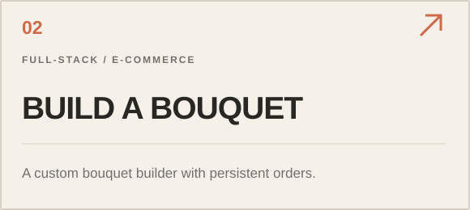
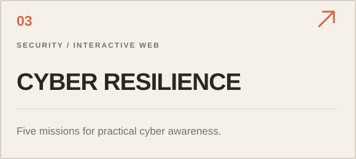
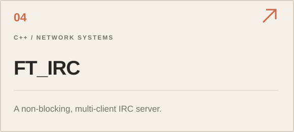
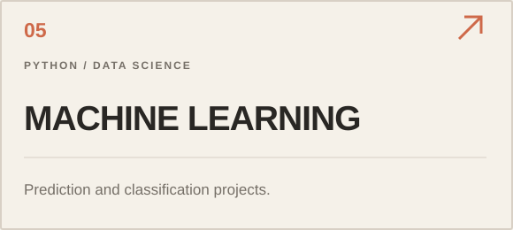
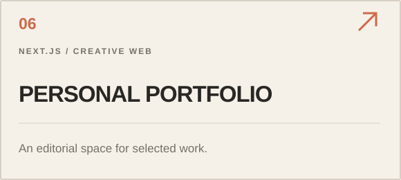
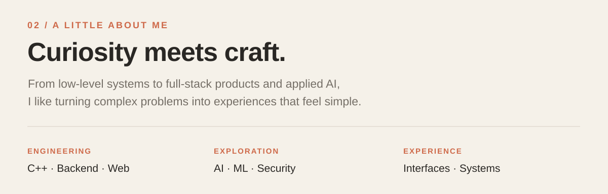
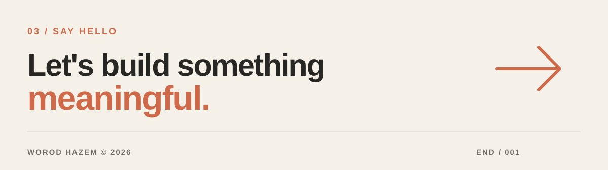

<!-- WOROD HAZEM — MINIMAL CREATIVE STUDIO -->
<!-- Asset files live in ./assets. GitHub renders them automatically. -->

  

  

    
    
    
  

 

  

<table>
<tr>
<td width="50%"></td>
<td width="50%"></td>
</tr>
<tr>
<td></td>
<td></td>
</tr>
<tr>
<td></td>
<td></td>
</tr>
</table>

 

  

### The toolkit

  
  
  
  
  
  
  
  
  

### Currently exploring

`AI systems` &nbsp; `Full-stack engineering` &nbsp; `Machine learning` &nbsp; `Systems design`

### A little GitHub activity

  

 

  

